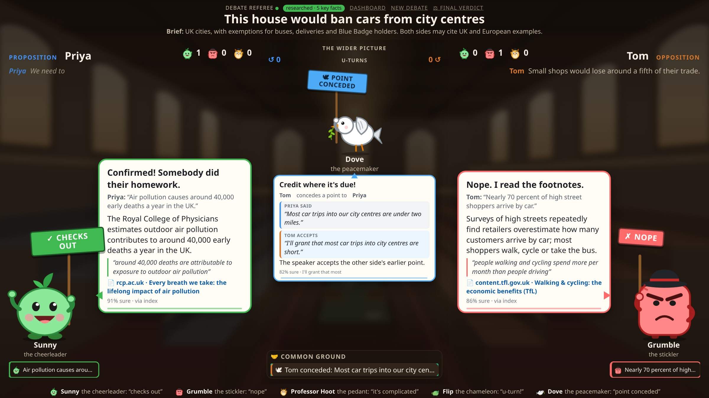
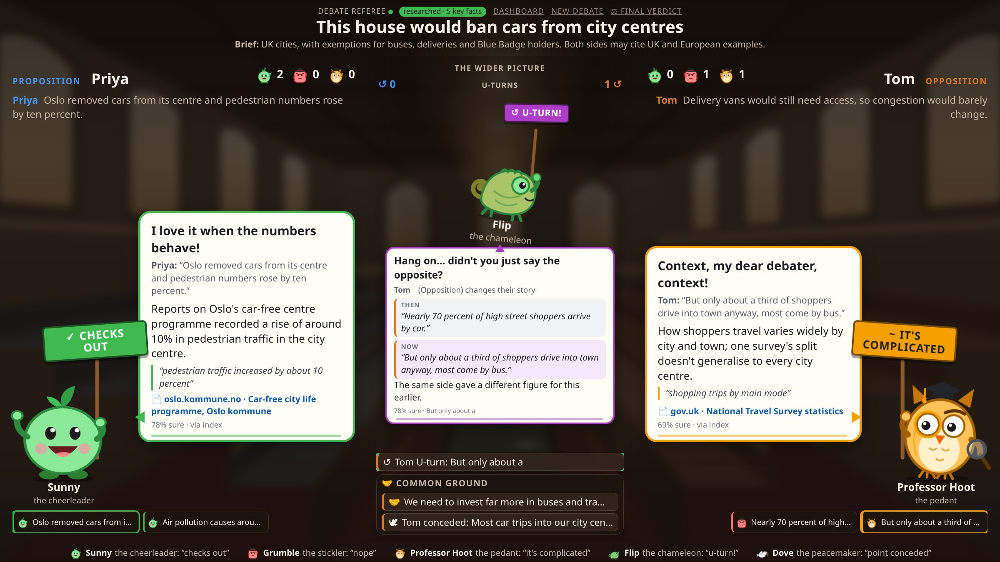
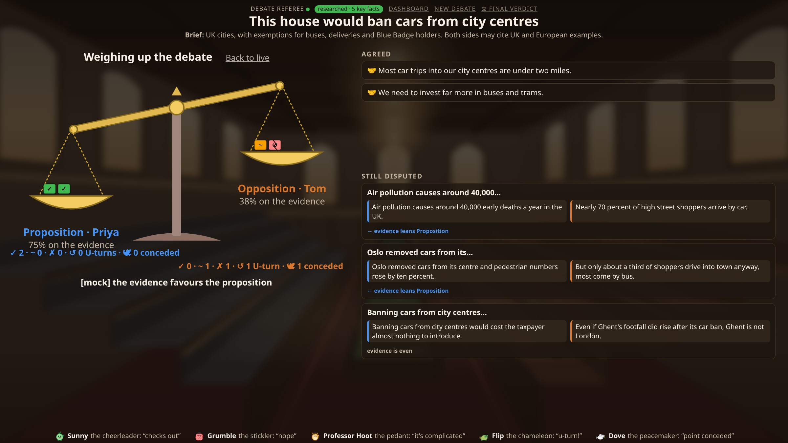

# Debate Referee: a live debate fact-checker

> *"By the time you'd typed a prompt about that claim, our agent had already checked it."*

An AI agent that **listens to a live debate, fact-checks every claim as it is spoken, and tracks how the
argument moves**: who backed a figure with evidence, who quietly changed their story, and who conceded
a point.

**The goal is an audience that is harder to mislead.** Debaters can quote a confident but wrong figure, and
it lands before anyone can check it. Debate Referee puts the evidence on screen beside the speakers while
the debate is still going. It never interrupts: the debate runs as normal, and the audience gets the
context they need to judge it for themselves.

Built in under 24 hours at **WHACK 2026** (London, 7–8 November 2026) for the **incident.io track**:
*build an agent that reacts to a live feed as it happens, with personality.*



---

## What it does

Two debaters speak into their own microphones. A few seconds after each sentence, the stage shows:

- **A verdict on every checkable claim**: *supported*, *contradicted*, *missing context* or
  *unverifiable*. Each one shows a verbatim quote and a link to its source. A cast of characters
  presents them: **Sunny** cheers a claim that checks out, **Grumble** the stickler says "nope", and
  **Professor Hoot** the pedant says "it's complicated".
- **The wider picture** in the centre lane. **Flip** the chameleon appears when a side contradicts its
  own earlier claim (a U-turn), with the "then" and "now" quotes side by side. **Dove** flies in when a
  side concedes a point. Shared positions collect under **Common ground**.
- **A final verdict**: a set of legal scales tipped by each side's evidence score, plus the points both
  sides agreed on and the issues still in dispute, with which way the evidence leans on each.





## How it works

```
2 mics (one per speaker, so no diarization)
  → Ears: local streaming speech-to-text (faster-whisper), sentence segmentation
  → Brain: claim extraction (Claude Haiku), argument map, consistency checker
  → Evidence: pre-researched index for the motion → web search fallback → verdict + verified quote
  → Stage: live two-sided view in the browser, final verdict screen
```

- **One process, one event bus.** FastAPI with asyncio queues. Modules talk only through typed events
  (`Utterance`, `Claim`, `Verdict`, `Consistency`, `DebateSummary`, ...), never by importing each other.
  A websocket fans events out to the browser.
- **Everything is replayable.** Every event is logged to JSONL with wall-clock timestamps. A logged run
  can be replayed through the live pipeline or straight to the UI, which gave us latency measurements,
  debugging and a demo fallback for free.
- **Pre-research is the speed trick.** When a motion is entered, the agent builds an evidence index for
  it before the debate starts, so most checks hit a local index instead of the web.
- **Anti-hallucination guards in code.** A verdict must quote its evidence, and code checks that the
  quote really appears in the retrieved source; if it doesn't, the verdict is dropped. Numeric claims are
  compared in code, not by the model. When unsure, the verdict is *unverifiable*.
- **Measured, not guessed.** A hand-labelled 20-claim eval set gated every model change: **zero
  fabricated quotes** across all runs, about 1.6 s p95 per verdict on Claude Haiku. The project has
  500+ automated tests, and CI/CD deploys every push to `master` to a Vultr server in London.

## My contributions (Thomas Read)

**I proposed the original idea**, along with its focus on the audience: helping viewers resist
misinformation without interrupting the debaters. Early ideas were narrators and commentators. The team adopted a test:
*an agent must decide something, and its actions must change what happens next.* A live debate
fact-checker passes it. The team was three people, and I owned the **Ears** (speech input) and the
**Face** (the stage UI), and also built the consistency checker.

### Ears: real-time speech-to-text
- Built the live transcription pipeline (`ears/ears.py`) with **faster-whisper** running locally:
  one audio channel per speaker from two microphones, which avoids error-prone speaker diarization.
- It runs Whisper over a sliding window (4 s window, 0.5 s hop) and **merges overlapping windows word by
  word**. The newest window wins where it heard more context, while a head margin protects words cut off
  at a window's edge. Words heard twice because of timestamp jitter are removed.
- Wrote the **sentence segmentation** so that only finished sentences go downstream: it handles
  abbreviations ("U.S.", "Dr."), ellipses, punctuation that Whisper splits off ("57 %"), and speakers who
  trail off without a full stop. It emits one JSON line per sentence, with timing and confidence, which
  a small bridge turns into `Utterance`/`Pause` events.

### Face: the stage UI
- Designed and built the **character-based stage view** (`/stage`) in plain HTML/CSS/JS with no build
  step: two sides, a cast of characters per verdict type, speech bubbles with the claim, explanation,
  source quote, link and confidence, per-side scoreboards, a clickable history of past checks, and an
  illustrated hall background (SVG).
- Built the **setup screen**: enter a motion, a brief and the speakers' names, then "Research this
  debate" runs pre-research with a live progress bar before the debate starts. This needed new events
  in the shared schema and changes to the evidence pre-research job.

### Consistency checker and final verdict
- Wrote `app/brain/consistency.py`, which weighs each new turn against everything said earlier and
  detects **self-contradictions (U-turns), concessions, agreements and corrections**. A "correction" is a
  side updating its figure after a fact check, which shouldn't count as a U-turn.
- It runs **cheap first**: code finds candidate pairs (shared content words, figures, or markers like
  "I'll grant"), and a turn with no candidates costs no model call. Otherwise it makes one LLM call per
  turn, with the debate so far sent as append-only blocks so it hits Anthropic's **prompt cache**. Code
  guards follow: quotes must be verbatim, ids must be earlier claims, confidence must clear a threshold,
  and *"even if ..."* is never a concession. A deterministic heuristic covers the clear cases if the
  model is unavailable.
- Built the **end-of-debate summary** and the legal-scales final screen. The model groups the debate into
  agreed and disputed points, but **code, not the model, decides which way the evidence leans**, using
  the verdicts. Added an eval script (`eval/eval_consistency.py`) against planted cases, with a target of
  zero false U-turns.

## Team

- **Thomas Read** ([`dy-dt`](https://github.com/dy-dt)): original idea, Ears, Face (stage UI),
  consistency checker
- **Tong** ([`dabestthebest`](https://github.com/dabestthebest)): Brain (claim extraction, argument map),
  event bus and schemas, integration lead
- **Harkaran Bual** ([`JollyPerson`](https://github.com/JollyPerson)): Evidence (pre-research,
  retrieval, verdicts), the eval set, deployment and the demo script

## Tech

Python · FastAPI · asyncio · WebSockets · faster-whisper · Claude (Haiku) via the Anthropic API ·
fastembed + BM25 retrieval · Pydantic · vanilla JS/CSS/SVG · pytest · Docker · Caddy · GitHub Actions ·
Vultr

## Run it

```bash
./run.sh mock                        # whole pipeline on mocks, no API keys
FIXTURE=fixtures/consistency_debate.jsonl ./run.sh mock    # then open http://localhost:8000/stage
./run.sh drive                       # a recorded debate through the real pipeline (needs keys in .env)
cd ears && ./runstt.sh | python bridge.py --url http://localhost:8000    # live mics
```

*The screenshots come from a scripted test debate replayed through the pipeline, with a stand-in
evidence module, so they show the UI without API keys. The characters are drawn in the app itself.*
